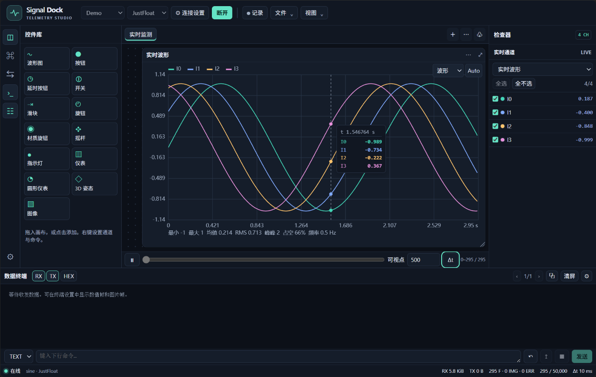

# Signal Dock

**写固件、看波形、调参数，都在 VS Code 里。**

调板子的时候，串口滚过几屏数字，还是得停下来想一想刚才到底是哪一路抖了。我想要的是转一下板子就能看到姿态，鼠标划到尖峰上就能读出那一刻各路的值，有用的一段顺手存成 CSV。Signal Dock 就是为这个场景做的。



## 两分钟上手

目前安装包面向 **Windows x64**，需要桌面版 **VS Code 1.100 或更新版本**。

1. 从 [GitHub Releases](https://github.com/MYFSillyBa/signal-dock/releases/latest) 下载 `signal-dock-win32-x64.vsix`，在 VS Code 扩展视图的菜单里选 **从 VSIX 安装**。
2. 在活动栏打开 **Signal Dock**。手边没有板子的话，先点 **运行 Demo**，可以直接试缩放、游标和 3D 姿态。
3. 接上板子后，在顶部选串口、波特率和协议，点 **连接**。串口列表会随插拔刷新，只有一个 USB 串口时会优先选中。数据位、校验、停止位和流控在 **连接设置** 里调整。

## 调试时怎么用

- **看波形**。在右侧勾选想看的通道。图内滚轮缩放双轴，轴上滚轮只缩放对应轴，拖动平移，点 **Auto** 回到实时。鼠标移到波形上，虚线旁会显示同一时刻的各路数值。也可以切到 XY、FFT、直方图或条形图。
- **看姿态和仪表**。从控件库拖入 3D 姿态、表盘、指示灯或图片。3D 支持欧拉角、四元数和 OBJ/STL 模型，默认斜视的 Z 轴朝上，X、Y、Z 直接标在轴端。 [3D 姿态截图](docs/3d-axis-preview.png)
- **发命令**。底部终端可看 RX/TX 和 Hex 数据，可发送文本、字节或文件。常用命令可以分组，也可以用 `set:%.2f,%d` 或 `FA FB %% FB FA` 这类模板绑定按钮、滑条和摇杆。
- **留一份数据**。点 **记录** 持续写 CSV，也可以从 **文件** 导出当前缓冲区或载入历史 CSV。布局和命令树跟着工作区保存，支持导入 VOFA+ 1.3 的 `vnumber: 100` 配置。

数据源支持串口、TCP 客户端、TCP 服务端、UDP 和 Demo。内建解码器包括 **JustFloat、FireWater、RawData**。有数据文件时，Demo 也能从目录播放 CSV 或 JPG。

### 串口例子

实机用 STM32 转发过一组 HI05 的 10 通道 JustFloat 数据，在 **921600 baud** 下，电脑端实测收到约 **1000 帧/s**。每帧包含各通道在同一时刻的一个样本，10 路各自都是约 1 kHz。实际帧率可以用底栏 `F` 计数在一段时间内的增量来估算。

如果固件每隔 1 ms 发一帧，把工作台的 **Δt** 设为 `1 ms`。这个值用来计算时间轴和 FFT 频率。串口速率和帧格式按发送端设置，界面刷新率可以单独在 **视图 → 外观与性能** 调整。

## 自定义扩展

其他 VS Code 扩展可以激活 `MYFSillyBa.signal-dock` 并调用导出的 `registerDecoder(name, factory)`。工厂按对端创建解码器，接收可选的 `expectedChannels`，返回 `push(Buffer)` 和可选的 `flush()`。数值帧形状为 `{kind: 'sample', values, bytes}`，图片帧为 `{kind: 'image', id, width, height, format, data, bytes}`。注册返回可释放对象。

在可信工作区，从 **视图 → 协议和控件扩展** 定义 JavaScript 控件。沙箱提供 `output`、`onSamples(callback)` 和绑定命令后的 `send(params)`。原 VOFA+ Qt 插件需要迁移到这些接口。

## 本地构建

```powershell
npm ci
npm test
npm run build
npm run package
```

遇到问题欢迎开 Issue。如果方便，带上连接类型、协议、串口参数和一小段能复现的输入，排查起来会快很多。 [提交 Issue](https://github.com/MYFSillyBa/signal-dock/issues)

## 参考与致谢

- **VOFA+** 提供了协议兼容和日常调试的参考。Signal Dock 按公开文档实现 JustFloat 和 FireWater，保留 RawData 查看原始字节的用法。波形图的单轴缩放、游标读数、通道绑定，以及用 Δt 设置时间轴，也参考了 VOFA+ 的操作习惯。 [协议引擎文档](https://www.vofa.plus/docs/learning/dataengines/introduce/) · [波形图文档](https://www.vofa.plus/docs/learning/widgets/wave/)
- **Lissio** 提供了工作区布局和数据流组织的参考。Signal Dock 借鉴了把连接、协议解码和显示分层的思路，以及侧栏配合多标签仪表画布的布局。在 VS Code 里，扩展宿主负责收发和解码，Webview 负责绘制和交互。 [Lissio 仓库](https://codeberg.org/Horldsence/Lissio)
- **VOFA-NEXT** 是 Lissio 的早期项目名。早期 README 记录了把串口连接、协议选择、波形、原始数据和 3D 视图放在同一调试工作区的设计，这也是这里参考的工作流程。原 GitHub 地址目前返回 404，早期说明可在公开分叉中查看。 [原 GitHub 地址](https://github.com/Horldsence/vofa-NEXT) · [早期 README](https://github.com/sigerio/vofa-NEXT/blob/9ea4393f9745e82e9459cfd37dcf5530e8d4ab3d/README.md)

Signal Dock 的协议解析、图表和控件代码独立编写。感谢这些项目公开协议文档和设计思路。

## 许可证

Signal Dock 使用 [MIT 许可证](LICENSE)。
